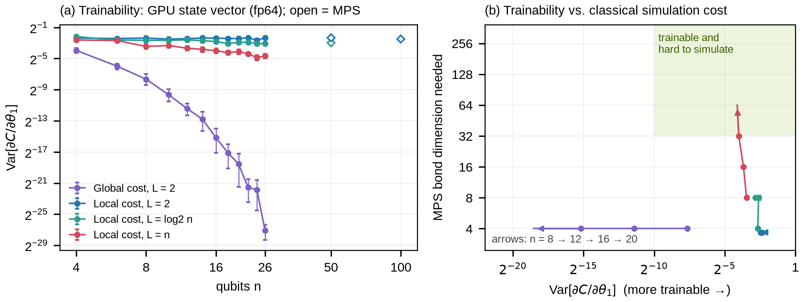

# Trainability vs. classical simulability: a HilbertBench pilot on CUDA-Q

Do variational quantum circuits that keep their gradient signal also stay easy to simulate classically? Cerezo et al. ([arXiv:2312.09121](https://arxiv.org/abs/2312.09121)) argue that provable absence of barren plateaus often comes with classical simulability. This pilot measures both sides on one GPU for four circuit families:

- **Trainability:** gradient variance against qubit count.
- **Classical simulability:** the matrix-product-state (MPS) bond dimension needed to reproduce the same cost landscape.

Every circuit execution was recorded through a prototype [HilbertBench](https://github.com/mamuncseru/hilbertbench) integration for CUDA-Q into a sealed, verifiable trace, which is included here.



*(a) Variance of the parameter-shift gradient against qubit count on the CUDA-Q `nvidia` target (fp64, 200 random draws per point, 95% bootstrap intervals). Open diamonds are `tensornet-mps` runs at 50 and 100 qubits. (b) Each configuration's path as n grows from 8 to 20: gradient variance against the smallest MPS bond dimension that reproduces its cost values to within 10% of their spread. Shading uses illustrative thresholds.*

## Setup

All circuits use a hardware-efficient ansatz: L layers of RY on every qubit followed by a CZ ladder, then a final RY layer. Gradients are exact parameter-shift derivatives with respect to the first parameter, at uniform random initialization.

| Configuration | Cost observable | Layers L |
| --- | --- | --- |
| `global_shallow` | Z₀Z₁…Zₙ₋₁ | 2 |
| `local_shallow` | Z₀Z₁ | 2 |
| `local_log` | Z₀Z₁ | ⌈log₂ n⌉ |
| `local_deep` | Z₀Z₁ | n |

- **Hardware:** one NVIDIA A40 (46 GB) on a university SLURM cluster, driver 555.42.06.
- **Software:** CUDA-Q 0.14.2 (`nvidia` target in fp64; `tensornet-mps` for MPS), HilbertBench 1.0.
- **Sweep:** n = 4 to 26 in steps of 2, 200 draws per point, so 400 circuit executions per point and 19,200 in total.
- **MPS check:** 20 draws at n = 8, 12, 16, 20, with maximum bond dimension χ ∈ {2, 4, …, 256} and truncation cutoffs set to 10⁻¹², so χ is the only truncation.

## Results

| Configuration | Decay rate b, Var ∝ 2^(−bn), n ≥ 6 (95% CI) | Var at n = 4 | Var at n = 26 | MPS χ needed at n = 8 / 12 / 16 / 20 |
| --- | --- | --- | --- | --- |
| `global_shallow` | 0.984 (0.940–1.062) | 0.064 | 7.1 × 10⁻⁹ | 4 / 4 / 4 / 4 |
| `local_shallow` | 0.001 (−0.010–0.012) | 0.193 | 0.199 | 4 / 4 / 4 / 4 |
| `local_log` | 0.026 (0.014–0.038) | 0.219 | 0.117 | 4 / 8 / 8 / 8 |
| `local_deep` | 0.091 (0.077–0.105) | 0.162 | 0.039 | 8 / 16 / 32 / 64 |

- **Linear-depth local-cost circuits are the open case.** Their gradient variance fell only about fourfold from 4 to 26 qubits, while the bond dimension an MPS needed to reproduce them doubled every four qubits. A power law Var ∝ n^(−0.90) fits about as well as the exponential (ΔAIC = 2.6).
- **Shallow local-cost circuits at 100 qubits:** `tensornet-mps` gives gradient variance 0.196 at n = 50 and 0.174 at n = 100. The 400 circuits at n = 100 took 283 s on one GPU. Log-depth circuits at n = 50: 0.127.
- **GPU vs. CPU throughput** (circuits per second, `local_deep`, one broadcast `observe` call):

  | n | 8 | 12 | 16 | 20 | 22 | 24 |
  | --- | --- | --- | --- | --- | --- | --- |
  | `qpp-cpu` (16 threads) | 26.9 | 10.5 | 1.12 | 0.043 | 0.007 | not run |
  | `nvidia` (A40, fp64) | 29.2 | 15.3 | 9.08 | 5.13 | 2.92 | 1.06 |

  The GPU is 120× faster at 20 qubits and about 400× at 22. At 8–12 qubits, a fixed cost of about 30 ms per circuit dominates and the GPU is within 1.5× of the CPU.
- **Recording cost and integrity:** HilbertBench recording added 0.2–0.4% to GPU wall time. The sealed trace verifies, holds 19,200 spans, and reproduces every gradient variance exactly when re-analyzed from the trace alone.

## What this does and does not show

- **The shallow results are expected, not discoveries.** Two CZ layers cap the bond dimension at 4, and shallow local-cost trainability is known (Cerezo et al., *Nature Communications* 12, 1791, 2021). They are here as controls.
- **The linear-depth behaviour may be a small-size effect.** Over 4–26 qubits, exponential and polynomial decay cannot be told apart reliably.
- **Only one classical method was tested.** Pauli propagation, Clifford-augmented MPS, or light-cone tensor contraction may simulate these circuits far more cheaply than plain MPS.
- **The bond dimension is set by a chosen tolerance:** reproduce cost values to within 10% of their spread over 20 draws. Exact reproduction of the deep circuits needs χ = 2^(n/2).
- **Only ∂C/∂θ₁ at uniform random initialization is measured,** not gradients along an optimizer's trajectory.

## Reproduce

```bash
python3 -m venv .venv && .venv/bin/python -m pip install -r requirements.txt
sbatch slurm/pilot_variance.sbatch      # gradient-variance sweep, recorded by HilbertBench (about 1 h on an A40)
sbatch slurm/pilot_rest.sbatch          # exact values and MPS bond-dimension sweep (about 1.5 h)
sbatch slurm/pilot_large_timing.sbatch  # 50- and 100-qubit MPS runs, CPU/GPU timing (about 1 h)
.venv/bin/python analyze.py             # fits, Figure 1, results/summary.json, trace verification
```

`analyze.py` runs on the committed results without a GPU. It restores `results/trace/events.jsonl` from the compressed copy, byte for byte, and verifies the seal.

**Driver note:** CUDA-Q 0.16 segfaulted on the `nvidia` target with driver 555 (CUDA 12.5), and NVIDIA's forward-compatibility package does not support that driver branch. Version 0.14.2 works.

## HilbertBench CUDA-Q integration (prototype)

`hb_cudaq.py` interposes on `cudaq.observe` and `cudaq.sample`, including broadcast calls, without changing the user's code, arguments or shot counts:

```python
from hilbertbench.recorder.tape import HilbertTape
from hb_cudaq import record_cudaq

with HilbertTape("runs") as tape, record_cudaq(tape):
    cudaq.observe(kernel, hamiltonian, parameter_sets)   # unchanged user code
```

Each execution becomes one span holding the kernel IR, parameters, observable and outcome, plus the wall time of the call. Not yet covered: `observe_async` / `sample_async`, C++ kernels, and noise-model capture.

## Files

| Path | Contents |
| --- | --- |
| `circuits.py` | Ansatz builder, observables, parameter-shift gradient |
| `hb_cudaq.py` | Prototype HilbertBench integration for CUDA-Q |
| `pilot.py` | Experiment stages: `variance`, `exact`, `mps`, `large`, `timing` |
| `analyze.py` | Decay-rate fits with bootstrap intervals, MPS bond dimension, timing, trace check, Figure 1 |
| `results/` | Raw outputs, `summary.json`, `figure1_pilot.png`, and the sealed trace in `results/trace/` |

## How this was built

The study design, code and analysis were developed with an AI coding agent (Claude Code) under my direction, and I ran the experiments on a university cluster. Every number above comes from the committed result files and can be regenerated with the scripts.

Md. Abdullah Al Mamun · [mamuncseru.github.io](https://mamuncseru.github.io) · MIT License
